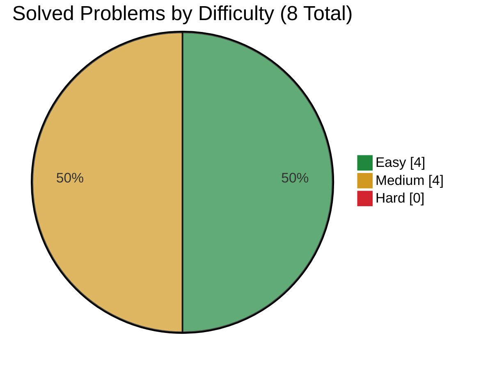

# Amazon

> This file is generated from [`company.json`](company.json). Do not edit it directly.

[← Companies](../README.md) · [Project README](../../README.md)

**Source:** Manual entries only

## Progress

- **Solved:** 8 / 8
- **In progress:** 0
- **Planned:** 0

<div align="center">



</div>

| Rank | Problem | Frequency | Difficulty | Status | Personal | Solution |
|---:|---|---:|:---:|:---:|:---:|---|
| Manual | [Merge Two Sorted Lists](https://leetcode.com/problems/merge-two-sorted-lists/) | Not sourced | Easy | Solved | 2 | [21.py](solutions/21.py) |
| Manual | [Search a 2D Matrix](https://leetcode.com/problems/search-a-2d-matrix/) | Not sourced | Medium | Solved | 2 | [74.py](solutions/74.py) |
| Manual | [Linked List Cycle](https://leetcode.com/problems/linked-list-cycle/) | Not sourced | Easy | Solved | 2 | [141.py](solutions/141.py) |
| Manual | [Reorder List](https://leetcode.com/problems/reorder-list/) | Not sourced | Medium | Solved | 4 | [143.py](solutions/143.py) |
| Manual | [LRU Cache](https://leetcode.com/problems/lru-cache/) | Not sourced | Medium | Solved | 4 | [146.py](solutions/146.py) |
| Manual | [Reverse Linked List](https://leetcode.com/problems/reverse-linked-list/) | Not sourced | Easy | Solved | 2 | [206.py](solutions/206.py) |
| Manual | [Binary Search](https://leetcode.com/problems/binary-search/) | Not sourced | Easy | Solved | 2 | [704.py](solutions/704.py) |
| Manual | [Koko Eating Bananas](https://leetcode.com/problems/koko-eating-bananas/) | Not sourced | Medium | Solved | 4 | [875.py](solutions/875.py) |

## Attempt details

The [complexity notes](../../docs/DATA_MODEL.md#complexity-conventions) explain how I count time and space. I use source frequency to choose what to practice, not to predict interview questions.

| ID | Time | Space | Notes |
|---|---|---|---|
| 21 | O(n + m) | O(1) auxiliary space | n and m = number of nodes in the two input lists; reuses existing nodes |
| 74 | O(log(m \* n)) | O(1) auxiliary space | m = number of rows; n = number of columns; binary search treats the nonempty sorted matrix as a flat sequence without copying it |
| 141 | O(n) | O(1) auxiliary space | n = number of distinct nodes reachable from head; uses Floyd's slow and fast pointers |
| 143 | O(n) | O(1) auxiliary space | n = number of nodes in the linked list; splits the list, reverses the second half, and interleaves existing nodes |
| 146 | Expected O(1) per get; expected amortized O(1) per put; O(1) initialization | O(c) for the hash map and doubly linked list | c = cache capacity; at most c cached entries remain after each operation, plus two sentinel nodes. A new put can temporarily hold c + 1 entries before eviction; hash-map resizing is amortized |
| 206 | O(n) | O(1) auxiliary space | n = number of nodes in the linked list; reverses the list in place |
| 704 | O(log n) | O(1) auxiliary space | n = number of elements in the sorted input list |
| 875 | O(n log M), or O(n) when M = 1 | O(1) auxiliary space | n = number of piles; M = largest pile size; each binary-search step sums required hours using a generator without storing per-pile results |

## Commands

Run these from the repository root, replacing the placeholders with your values. Anything in square brackets is optional. For source commands, set up the company’s source first and run `source-sync` before `next` or `add-from-source`.

```text
node scripts/company-tracker.js source-sync amazon
node scripts/company-tracker.js next amazon
node scripts/company-tracker.js add-from-source amazon <source-key> [--id problem-id]
node scripts/company-tracker.js add-problem amazon <id> "<title>" <Easy|Medium|Hard> [--url URL]
node scripts/company-tracker.js start amazon <id>
node scripts/company-tracker.js solve amazon <id> --time "O(...)" --space "O(...)" [--personal-difficulty 1-10]
```
